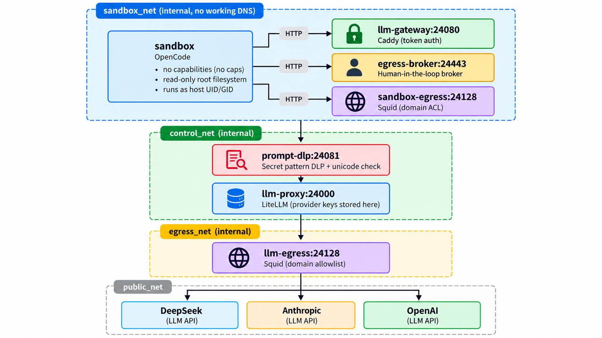

# Agent Paladin

<p align="center">
  
</p>

**Agent Paladin** is a defense-in-depth security guardian for running autonomous coding agents ([OpenCode](https://opencode.ai) with DeepSeek, Claude, GPT, or Ollama) on your laptop. It is designed to avoid giving untrusted models access to your host system, your cloud credentials, or unrestricted internet.

The architecture assumes that any autonomous agent can be **prompt-injected** by malicious repository content, hidden files, or external tool outputs. Paladin stands between the agent and your machine, reducing the blast radius of a compromised or prompt-injected agent.

No security tool can guarantee protection. Paladin is a defense-in-depth hardening layer, not a substitute for reviewing code, keeping backups, or complying with your model provider's terms. See **[License, third-party components, and disclaimer](#license-third-party-components-and-disclaimer)**.

> **Use at your own risk.** Paladin runs autonomous agents that can execute destructive commands, including `rm -rf`, and modify or delete files. Snapshot mode confines changes to a disposable snapshot; direct modes can affect your real project. You are responsible for backups and for reviewing changes.

---

## What Agent Paladin Does For You

* **Helps Protect Your Host**: The agent runs in an isolated, read-only Docker container with zero Linux capabilities (`cap-drop ALL`, `no-new-privileges`).
* **Shields Your Secrets**: Cloud and provider API keys live solely inside an isolated gateway proxy—the agent inside the sandbox is not given them.
* **Blocks General Internet / Exfiltration**: The sandbox operates on an internal Docker network with **no working DNS path** (Docker's embedded resolver is explicitly dropped) and default-DROP firewall rules. Internet access is disabled by default.
* **Inspects Prompts with DLP**: A dedicated DLP proxy scans outgoing prompts for credentials, database URLs, and API tokens before they reach the LLM provider.
* **Disposable Workspace Snapshots**: By default, Paladin creates a disposable snapshot of your code. Your host `.git` and `.env` files are not mounted by default. The opt-in direct modes are reduced-assurance; they mask credential files and stores such as `.env`, `.ssh`, `.aws`, and `secrets/` by default.
* **Human-in-the-Loop Gate**: In the default snapshot workflow, Paladin is designed to prevent the agent from adding malicious Git hooks, CI workflows, or backdoors to your repo. You review a clean patch before applying it. Direct modes write to the host immediately and are only audited after the fact.
* **Seamless Multi-Project Laptop Use**: Install the `paladin` CLI once. Then `cd` into **any** of your projects and run `paladin`—it automatically applies the same controls to that directory.

---

## 3-Minute Laptop Setup

### Prerequisites
* **Docker Engine** or **Docker Desktop** (running on your Mac or Linux laptop).
* **Python 3.10+** and **Git** on your host.

### Step 1: Clone and install the CLI
```sh
git clone https://github.com/mzaheenuddin/AgentPaladin.git ~/AgentPaladin
cd ~/AgentPaladin

# Link 'paladin' to ~/.local/bin so it works from any terminal window
./bin/paladin install-cli
```
*(Make sure `~/.local/bin` is in your shell `PATH` by adding `export PATH="$HOME/.local/bin:$PATH"` to your `~/.zshrc` or `~/.bashrc`).*

### Step 2: Initialize secrets
```sh
paladin init
paladin secrets set DEEPSEEK_API_KEY
# Optional (if using Anthropic or OpenAI models):
# paladin secrets set ANTHROPIC_API_KEY
# paladin secrets set OPENAI_API_KEY
```

### Step 3: Run preflight & build
```sh
paladin preflight    # Verifies host & Docker isolation posture
paladin build        # Builds local hardened container images
```

You are ready to go!

---

## Working Across Multiple Projects

You do not need to keep moving files into Paladin or hardcoding paths. You can run Paladin from **any project on your laptop**:

### Normal Workflow (Disposable Snapshot)

```sh
# 1. Go to any project on your machine
cd ~/GitHub/my-awesome-app

# 2. Start Agent Paladin (automatically snapshots the current project)
paladin

# 3. Work with the agent in the sandbox...
# When finished, exit OpenCode. Paladin generates a clean patch and safety report.

# 4. Review the patch and apply it:
paladin export            # Inspect changes.patch and report.json
paladin export --apply    # Safely apply reviewed changes to your project
```

---

## Profiles & Common Modes

Profiles let you adjust egress and network permissions depending on what the agent needs:

| Profile | Workspace | Egress | Description |
|---|---|---|---|
| `edit` *(default)* | Sanitized snapshot | **Deny** | Standard offline coding. No internet access except the authenticated LLM gateway. |
| `install` | Sanitized snapshot | **Allowlist** | Grants HTTPS access only to approved package registries (npm, PyPI). |
| `api` | Sanitized snapshot | **Approval Broker** | Allows specific API calls (e.g. GitHub API) only after you approve each request. |
| `local` | Sanitized snapshot | **Deny** | Runs locally with Ollama (no external cloud LLM is used by default). |
| `confidential` | Sanitized snapshot | **Deny** | Requires `--ack-external-model` acknowledgement that code is transmitted to the cloud LLM provider. |

### Examples:

```sh
# Need npm packages or docs during the session?
paladin --profile install --allow registry.npmjs.org

# Need approved API calls?
paladin --profile api

# Switch model:
paladin --model claude-sonnet-5-5

# Need a debug shell inside the container?
paladin shell
```

---

## Human-in-the-Loop Egress Broker

When running in `--profile api`, the agent cannot access the internet directly. If it needs to call an external API (like GitHub):

1. The agent sends an HTTP request to `http://egress-broker:24443/request`.
2. The broker scans the payload for secrets, strips unauthorized headers, and queues the request.
3. On your host terminal, inspect and approve it:
   ```sh
   paladin pending        # View queued requests with safe terminal formatting
   paladin approve <id>   # Authorize and dispatch the single request
   paladin deny <id>      # Reject the request
   ```
4. The broker injects your configured API token, makes the call, scans the response for leaked secrets, and returns the result to the agent.

---

## Security Architecture

<p align="center">
  
</p>

<p align="center"><sub>Third-party product names are used for identification only. The visible diagram contains no third-party logos. See <a href="NOTICE">NOTICE</a>.</sub></p>

<details>
<summary>View ASCII Architecture Diagram</summary>

```text
                        sandbox_net (internal, no working DNS)
   ┌──────────────────────────────────────────────────────────────┐
   │ sandbox: OpenCode, no caps, read-only root, host UID/GID      │
   │   └── HTTP ──► llm-gateway:24080 (Caddy, token auth)          │
   │   └── HTTP ──► egress-broker:24443 (human-in-the-loop broker) │
   │   └── HTTP ──► sandbox-egress:24128 (Squid domain ACL)        │
   └──────────────────────────────────────────────────────────────┘
                               │ control_net (internal)
                               ▼
                     prompt-dlp:24081 (secret pattern DLP + unicode check)
                               │
                               ▼
                     llm-proxy:24000 (LiteLLM, provider keys stored here)
                               │ egress_net (internal)
                               ▼
                     llm-egress:24128 (Squid domain allowlist)
                               │ public_net
                               ▼
                     DeepSeek / Anthropic / OpenAI
```

</details>

* **No direct internet**: The sandbox has no default route and `/etc/resolv.conf` points to a dead loopback address. Docker's embedded resolver at `127.0.0.11` is dropped explicitly; the supplied configuration blocks resolution and DNS tunneling.
* **One-shot Netns Firewall**: Default-DROP for incoming, outgoing, and forwarded traffic. Only loopback, established/related traffic, and the selected gateway/proxy ports are allowed; Docker's embedded DNS is excluded.
* **Reduced Host Exposure in Snapshot Mode**: Snapshot runs do not mount the host `.git` history, `.env` files, SSH keys, or the Docker socket. Direct modes are reduced-assurance opt-ins; they mount the project and mask common credential stores.

---

## Verification & Auditing

After any configuration change or setup, verify the entire isolation stack:

```sh
paladin verify
```
This tests:
* Container posture: non-root, read-only root, no privileges, no Docker socket, no leaked provider keys.
* Network boundaries: dead DNS (including Docker's `127.0.0.11`), dropped public routing, unreachable metadata endpoints (`169.254.169.254`).
* Git hook canaries: confirms hooks cannot execute.
* DLP enforcement: confirms canary secrets and unicode-escaped credentials are blocked.

---

## Project Layout

```text
assets/               Project artwork
bin/                  CLI commands (paladin, agent, export, secrets, verify)
docs/                 Detailed operator runbook (docs/GUIDE.md)
compose.yaml          Core Docker Compose topology and service hardening
compose.egress.*.yaml Egress profile overlays (allowlist, broker)
config/models.json    Supported model aliases and configurations
config/opencode/      Read-only OpenCode system policies and instructions
config/broker/        Approval broker settings and credential mappings
docker/agent/         Hardened OpenCode image and security test suite
docker/gateway/       Authenticated Caddy gateway
docker/prompt-dlp/    Prompt secret-pattern guardrail service
docker/litellm/       Pinned LiteLLM proxy holding provider keys
docker/egress/        Squid domain-allowlist proxy
docker/egress-broker/ Human-in-the-loop API approval broker
docker/firewall/      One-shot netns firewall container
scripts/              Snapshot, scan, export gate, and preflight tools
secrets/              Local secret files (mode 0600; never committed)
NOTICE                Copyright and third-party trademark/asset notices
THIRD_PARTY_NOTICES.md Container images, model providers, and asset notices
SECURITY.md           Vulnerability reporting and security scope
CONTRIBUTING.md       Contribution licensing and DCO
RELEASING.md          Pre-publication and release checklist
```

---

## Operator Guide

For advanced configuration, tuning model aliases, troubleshooting macOS/Linux Docker permissions, and detailed command flags, see the **[Operator Guide](docs/GUIDE.md)**.

---

## License, third-party components, and disclaimer

* **License**: Agent Paladin's source code, configuration, and documentation are licensed under the [Apache License 2.0](LICENSE). The license applies only to material the project has the right to license. Third-party software, container images, model weights, APIs, trademarks, logos, and brand assets remain under their own licenses and terms. See [NOTICE](NOTICE) and [THIRD_PARTY_NOTICES.md](THIRD_PARTY_NOTICES.md).
* **Risk and responsibility**: To the maximum extent permitted by law, you use the software at your own risk and are solely responsible for backups, reviewing changes, choosing the workspace mode, and any damage, data loss, or other loss arising from use. The Apache-2.0 warranty disclaimer and limitation of liability apply.
* **No warranty / no guarantee**: The software is provided "as is", without warranty or condition of any kind, express or implied, including warranties of title, non-infringement, merchantability, or fitness for a particular purpose. Paladin is a hardening tool, not a guarantee that a host, credential, or repository cannot be compromised. You are responsible for reviewing code, keeping backups, and deciding whether the isolation is sufficient for your risk model.
* **Your data and provider terms**: Prompts and code are sent to the model provider you configure. You are responsible for having the right to send that data and for complying with the provider's terms and applicable law, including confidentiality, GDPR, HIPAA, and sector-specific rules. Paladin cannot un-send data to a provider. Run directories, patches, and logs may also contain sensitive code or metadata; protect them and apply your own retention policy.
* **Built images**: The repository is source-only. If you build and distribute container images, you are distributing third-party packages inside them. In particular, the egress images contain Squid (GPL-2.0) and the sandbox image contains GPL-licensed Alpine packages. Those licenses impose their own notice and source-offer obligations; the Apache-2.0 license does not replace them. Do not describe an image containing GPL software as "Apache-2.0 only".
* **AI-assisted material**: The code and documentation were produced with AI assistance and reviewed or edited by the maintainer. AI-generated material may not be protected by copyright in every jurisdiction. The Apache-2.0 license is applied to the extent of the maintainer's rights, and no warranty of originality or non-infringement is provided.
* **Trademarks**: All product names, logos, brands, and registered trademarks (including DeepSeek, OpenCode, Claude, Anthropic, OpenAI, Docker, Squid, Caddy, LiteLLM, and Ollama) belong to their respective owners. Their reference in this project is solely for identification, interoperability, and descriptive purposes and does not imply endorsement, affiliation, or sponsorship. The Apache-2.0 license grants no rights to third-party trademarks or logos.
* **Security reports**: Please follow [SECURITY.md](SECURITY.md) and do not open a public issue for an undisclosed vulnerability.
* **Contributions**: Contributions are accepted under Apache-2.0 with a Developer Certificate of Origin sign-off. See [CONTRIBUTING.md](CONTRIBUTING.md).

This section is a summary, not legal advice. If you intend to use Agent Paladin commercially or in a regulated environment, have qualified counsel review the license, third-party terms, and your data flows.

